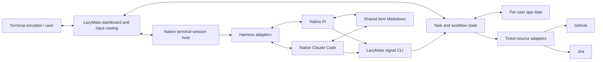
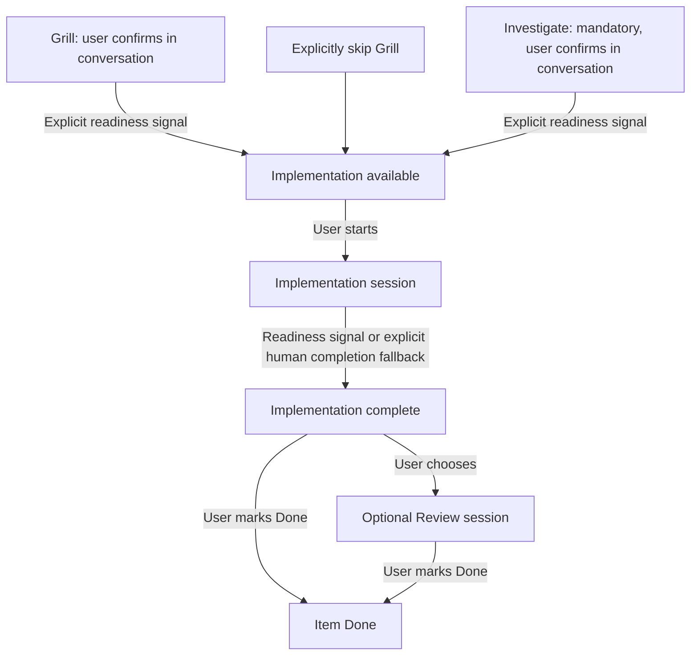

# LazyMate — Architecture Guide

Status: Initial handover draft. Product behavior comes from [product-brief.md](product-brief.md). Component boundaries below are guidance; no language, framework, terminal backend, database, or IPC transport has been selected.

## Design principle

LazyMate owns work tracking and workflow navigation. Native Pi and Claude Code own agent interactions. Do not replace either agent's native UI with RPC chat rendering without explicit product approval.

The first release targets macOS/Ghostty. Keep OS-dependent hosting, paths, and process control behind boundaries that can later support Linux/Windows; do not build or claim untested platform support.

## Components



### Dashboard

- Lazygit-inspired bordered Projects panel above active items; selected-item stages remain navigable.
- Arrow keys / j/k highlight projects; Enter selects; Tab changes panel focus.
- Default project view; hotkey toggles a flattened all-project view with project names and colors.
- Enter starts/opens an available stage. A separate action starts it without entering.
- Configurable LazyMate-owned return shortcut; Ctrl+B is the proposed default. Returning neither interrupts nor approves work.
- Finished visibility and item reopening are separate actions. Show blocked reasons and action/key hints.

### Ticket-source boundary

Support explicit search, fetch, and read-only import for GitHub and Jira; local creation needs no remote adapter. A project has one configured remote provider initially. GitHub import search initially targets that project's configured GitHub repository. Local repo identity must not depend on provider identity.

Persist remote host/source identity, stable remote ID, display key, URL, and a content snapshot. Reimporting a ticket within its project should resolve to its existing item. No issue writeback, background synchronization, or automatic assigned-ticket population is required.

GitHub CLI and Atlassian CLI are candidates, not decisions. Existing Claude Jira access is confirmed to use MCP; do not assume LazyMate can reuse that connection directly. See [ticket-source research](research/ticket-sources.md). Confirm deployment and approved access with the user before integration.

### Harness boundary

Support Pi and Claude Code, preserving existing login/configuration and native UI. Responsibilities include executable discovery, launch, stage instruction delivery, exact conversation-reference capture, resume, and supported interrupt/shutdown behavior. Verify installed CLI interfaces rather than invent flags.

Project default harness; per-stage override before first launch. Once created, a conversation stays associated with its harness. Cross-harness conversation conversion is outside scope. Model/provider controls are not selected for the MVP UI.

### Terminal session host — feasibility gate

Responsibilities: child terminal lifecycle, keyboard routing, output consumption, resize, background output handling, live-screen restoration, and clean dashboard restoration. A raw PTY is not a complete screen-restoration solution.

Potential strategies include a multiplexer behind a LazyMate-owned input proxy, or PTYs plus terminal-state emulation. Evaluate rather than prescribe. If tmux is used internally, users must not depend on configuring tmux keybindings, and its portability/feature constraints must be documented.

Validate native keyboard, tool/extension UI, multiline input, clipboard/image behavior, terminal modes, external editor behavior where used, and resize. Full native functionality is the goal; obtain agreement on any specific limitation. Do not silently downgrade to a custom chat client.

### Workflow and execution state

Keep three concepts distinct:

- Item lifecycle: active or Done.
- Stage workflow state: unavailable, available, ready, or explicitly skipped where permitted; a human-action blocker may also be recorded.
- Session execution: not launched, live, closed/exited, or failed. Activity/waiting-for-input may be unknown unless supported by reliable harness signals.

Exact enum names are implementation choices. Never equate process exit, idle output, or Markdown text with stage completion.



All launches are manual; readiness only changes availability. Review reports first and edits only when asked. Implementation still does its own normal verification. No automatic completion, review loop, or downstream restart when earlier sessions are revisited.

### Shared item document

Use per-user app data, not installation files or repository files by default. Suggested layout:

```text
<app-data>/projects/<project-id>/items/<item-id>/item.md
```

Use a platform-directory resolver. macOS normally uses ~/Library/Application Support/LazyMate. State storage format is undecided; do not mistake this example layout for a database choice.

Document sections: source snapshot/link; clarified requirements and acceptance criteria; investigation/approved approach; implementation and validation summary; review findings; blockers. Agents update narrative sections and users may edit the file externally. LazyMate stores authoritative workflow state separately. Agents should update only relevant sections, not rewrite the whole document. MVP has no collaborative editor or agent-write locking; arbitrary agent edits may conflict. LazyMate's own writes should be safe.

Human-action blockers persist on the item. Provide Open session and Clear blocker actions; clearing removes the blocker without automatically resuming or prompting the agent. The user continues the conversation.

Pass the absolute path to each session. Validate external-file permissions through each harness's normal permission model. Require a document update before readiness; existence can be checked, narrative correctness cannot. Avoid silently replacing an active document or overwriting another stage's contributions. Concurrency handling needs a bounded design.

### Explicit agent signals

Expose a small CLI callable through shell tools for readiness and blocking. Supply execution context automatically. Validate project/item/stage/execution identity, reject stale or mismatched requests, and make repeated reports safe. Do not let a report approve an unavailable stage, skip mandatory work, reopen a Done item, or launch another stage.

Exact syntax, transport, and local access controls are open. Treat this as local process coordination, not a sandbox that prevents a shell-capable agent from changing files. Keep credentials out of prompts/logs. Missing signals leave conversations usable; show unknown/unreported status rather than guessing, with manual readiness recovery. No automatic retry prompts.

### Working directories and worktrees

- Register an existing Git checkout; worktrees belong to that project.
- Grill/Investigate initially use the main checkout. Optional item worktree is created by LazyMate before implementation; Implementation and Review use that directory/branch. Earlier conversations keep their original directory.
- Offer isolation even without a conflict. Warn about potentially conflicting work but allow shared-checkout execution. Grill sessions do not trigger/impose this warning.
- Do not claim to detect arbitrary external agents unless implemented. Managed-session conflict detection and treatment of Investigation/Review need a final policy.
- Default worktree location is outside the repo under LazyMate app data. Suggest an item-based branch name and show the base branch/commit for confirmation or change. Never silently copy uncommitted changes. Detailed failure/dirty-checkout UX remains open.
- No automatic commit/push/merge/delete or worktree cleanup on Done. Manual Git operations remain possible inside native sessions.

### Lifecycle and recovery

Live sessions continue while the dashboard is visible. Re-entry restores their screen. Interrupt stops current work without closing the conversation; Close ends the process; Return changes UI only. Confirm actual harness behavior during the spike.

Orderly application exit warns about live sessions, shuts down managed processes, and restores the outer terminal. No detached daemon is required. After restart, use saved conversation references—not the latest conversation in a directory—to resume in new processes. Exact old screen/unsent text is not promised across restart.

Mark Done normally requires completed implementation. If live sessions exist, offer cancel, stop-and-Done, or keep-running-and-Done. Later signals do not reactivate the item. Showing finished items is separate from reopening, which preserves history.

Missing executables, invalid directories, missing conversation history, permission failures, crashes, and stale process references must surface actionable errors without losing task data. Bounded graceful shutdown and orphan handling need validation.

## Security and organizational boundaries

Employer permission for Claude/Jira does not imply permission for other providers or local exports. Confirm approved authentication and data handling before work-ticket tests. Do not commit credentials or employer data. Keep signal context, source credentials, and imported content out of unnecessary logs. Respect harness permissions; no unsafe-mode flags merely to bypass integration friction.

## Remaining decisions

See [decisions.md](decisions.md). Resolve only the choices needed for the current milestone; record evidence before committing to terminal or persistence technologies.
